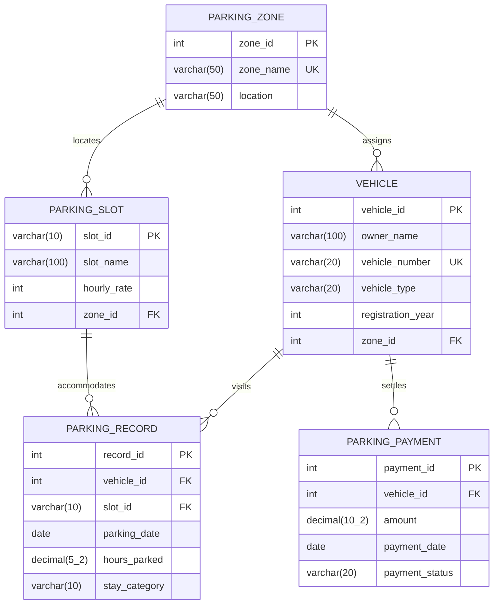

# Campus Parking Management System (DBMS PBL)

[](https://github.com/Surya-Paul/DBMS_PBL)
[](https://www.php.net/)
[](https://www.mysql.com/)
[](https://getbootstrap.com/)
[](LICENSE)

A complete, full-featured **Campus Parking Management System** built with **PHP 8+** and **MySQL 8+**, styled using **Bootstrap 5** and enhanced with **Vanilla JavaScript**. Designed for project-based learning (DBMS PBL) demonstrations and real-world campus parking administration.

**Repository:** [https://github.com/Surya-Paul/DBMS_PBL](https://github.com/Surya-Paul/DBMS_PBL)

---

## Quickstart (Clone & Run)

```bash
# 1. Clone the repository
git clone https://github.com/Surya-Paul/DBMS_PBL.git
cd DBMS_PBL

# 2. Start your local MySQL server (e.g. via Homebrew or XAMPP)
brew services start mysql

# 3. Start the PHP built-in server
php -S localhost:8000

# 4. Open the Web Setup Assistant in your browser
open http://localhost:8000/setup.php
```
Click **"Create & Seed Database"** in the Setup Assistant to initialize all tables and load realistic sample data with one click. Then explore the dashboard at [http://localhost:8000](http://localhost:8000)!

---

## Table of Contents
1. [Tech Stack](#tech-stack)
2. [Project Architecture & File Structure](#project-architecture--file-structure)
3. [Database Schema (`ParkingDB`)](#database-schema-parkingdb)
4. [Parking Stay Classification & Tariff Logic](#parking-stay-classification--tariff-logic)
5. [Local Setup Instructions](#local-setup-instructions)
   - [Method 1: PHP Built-in Server + MySQL (Recommended)](#method-1-php-built-in-server--mysql-recommended)
   - [Method 2: XAMPP Setup](#method-2-xampp-setup)
   - [Method 3: MAMP Setup](#method-3-mamp-setup)
6. [Database Initialization & Seed Data](#database-initialization--seed-data)
   - [1-Click Web Setup Assistant (`setup.php`)](#1-click-web-setup-assistant-setupphp)
   - [Terminal / CLI Import](#terminal--cli-import)
7. [Application Features Walkthrough](#application-features-walkthrough)
8. [Advanced Reports Suite (All 9 Reports)](#advanced-reports-suite-all-9-reports)
9. [Safe Dependency & Foreign Key Handling](#safe-dependency--foreign-key-handling)
10. [Configuration Reference](#configuration-reference)

---

## Tech Stack
- **Backend**: PHP 8.0+ using PDO (PHP Data Objects) with 100% prepared statements.
- **Database**: MySQL 8.0+ / MariaDB with strict Foreign Key constraints and `CHECK` validations.
- **Frontend**: HTML5, CSS3, Vanilla JavaScript (ES6+), Bootstrap 5.3 (CDN), Bootstrap Icons.
- **Environment**: Zero external API dependencies, zero cloud services, zero paid libraries. Runs completely offline on `localhost`.

---

## Project Architecture & File Structure

```
DBMS_PBL/
├── config/
│   ├── config.php             # Active database credentials (host, port, user, pass, db)
│   ├── config.example.php     # Template configuration file for deployment
│   └── db.php                 # PDO connection provider with connection error detection
├── sql/
│   ├── schema.sql             # Full DDL schema with tables, constraints, foreign keys
│   └── seed.sql               # Seed dataset in strict foreign-key dependency order
├── includes/
│   ├── header.php             # Persistent responsive navigation bar & diagnostic banners
│   ├── footer.php             # Page footer and script bundle imports
│   ├── flash.php              # Flash notification system (Success, Danger, Warning)
│   └── functions.php          # Stay classification, fee estimation, dependency checks
├── assets/
│   ├── css/
│   │   └── style.css          # Clean campus administrative styling
│   └── js/
│       └── app.js             # Vanilla JS: dynamic stay classification & tariff calculator
├── index.php                  # Interactive Dashboard with metrics, summaries, and activity
├── zones.php                  # Parking Zones CRUD with referential dependency protection
├── vehicles.php               # Vehicles CRUD with multi-criteria search and filtering
├── slots.php                  # Parking Slots CRUD with hourly tariff management
├── records.php                # Parking Records CRUD with auto-stay calculation & fee estimation
├── payments.php               # Payments CRUD with status tracking (Paid, Partial, Pending)
├── reports.php                # Reports Suite featuring all 9 advanced SQL analytical queries
├── setup.php                  # 1-Click Database Setup, Diagnostics & Seed Initializer
└── README.md                  # Comprehensive setup and usage documentation
```

---

## Database Schema (`ParkingDB`)

The database consists of 5 related relational tables enforcing referential integrity:



### Table Specifications & Constraints:
1. **`Parking_Zone`**:
   - `zone_id` INT AUTO_INCREMENT PRIMARY KEY
   - `zone_name` VARCHAR(50) NOT NULL UNIQUE
   - `location` VARCHAR(50) NULL
2. **`Vehicle`**:
   - `vehicle_id` INT AUTO_INCREMENT PRIMARY KEY
   - `owner_name` VARCHAR(100) NOT NULL
   - `vehicle_number` VARCHAR(20) NOT NULL UNIQUE
   - `vehicle_type` VARCHAR(20) NULL
   - `registration_year` INT NULL
   - `zone_id` INT FOREIGN KEY REFERENCES `Parking_Zone(zone_id)` ON DELETE RESTRICT ON UPDATE CASCADE
3. **`Parking_Slot`**:
   - `slot_id` VARCHAR(10) PRIMARY KEY (e.g., `S-A01`, `S-B01`)
   - `slot_name` VARCHAR(100) NOT NULL
   - `hourly_rate` INT NOT NULL DEFAULT 20
   - `zone_id` INT FOREIGN KEY REFERENCES `Parking_Zone(zone_id)` ON DELETE RESTRICT ON UPDATE CASCADE
4. **`Parking_Record`**:
   - `record_id` INT AUTO_INCREMENT PRIMARY KEY
   - `vehicle_id` INT FOREIGN KEY REFERENCES `Vehicle(vehicle_id)` ON DELETE RESTRICT ON UPDATE CASCADE
   - `slot_id` VARCHAR(10) FOREIGN KEY REFERENCES `Parking_Slot(slot_id)` ON DELETE RESTRICT ON UPDATE CASCADE
   - `parking_date` DATE NOT NULL
   - `hours_parked` DECIMAL(5,2) NOT NULL
   - `stay_category` VARCHAR(10) NOT NULL
   - `CONSTRAINT chk_hours_parked CHECK (hours_parked >= 0 AND hours_parked <= 24)`
   - `CONSTRAINT uq_vehicle_slot_date UNIQUE (vehicle_id, slot_id, parking_date)`
5. **`Parking_Payment`**:
   - `payment_id` INT AUTO_INCREMENT PRIMARY KEY
   - `vehicle_id` INT FOREIGN KEY REFERENCES `Vehicle(vehicle_id)` ON DELETE RESTRICT ON UPDATE CASCADE
   - `amount` DECIMAL(10,2) NOT NULL
   - `payment_date` DATE NOT NULL
   - `payment_status` VARCHAR(20) NOT NULL DEFAULT 'Paid'

---

## Parking Stay Classification & Tariff Logic

Stays are classified uniformly across the entire system:
- **Short**: Less than 4 hours (`hours_parked < 4.00`)
- **Medium**: 4 hours up to (not including) 8 hours (`hours_parked >= 4.00 AND hours_parked < 8.00`)
- **Long**: 8 hours or more (`hours_parked >= 8.00`)

### Tariff Calculation:
$$\text{Estimated Charge} = \text{hours\_parked} \times \text{hourly\_rate}$$
When creating or editing a parking record, vanilla JavaScript listens to input changes in real-time and dynamically updates both the stay category badge and the estimated fee before the form is submitted.

---

## Local Setup Instructions

### Prerequisites
- PHP 8.0 or newer
- MySQL 8.0+ or MariaDB 10.4+

---

### Method 1: PHP Built-in Server + MySQL (Recommended)

1. **Verify or start your local MySQL server**:
   Make sure MySQL is running on `127.0.0.1:3306` (e.g. via Homebrew `brew services start mysql`, or standalone MySQL server).

2. **Configure Database Credentials**:
   Inspect or edit [config/config.php](file:///Users/suryapaul/Downloads/DBMS_PBL/config/config.php):
   ```php
   return [
       'host'     => '127.0.0.1',
       'port'     => 3306,
       'database' => 'ParkingDB',
       'username' => 'root',
       'password' => '', // Set your MySQL root password if any
       'charset'  => 'utf8mb4'
   ];
   ```

3. **Start the PHP built-in web server**:
   From the project directory (`/Users/suryapaul/Downloads/DBMS_PBL`), run:
   ```bash
   php -S localhost:8000
   ```

4. **Initialize Database and Open the App**:
   - Open your browser to `http://localhost:8000/setup.php`
   - Click **"Create & Seed Database"**
   - Click **"Go to Dashboard"** (or open `http://localhost:8000/index.php`)

---

### Method 2: XAMPP Setup (Windows / macOS / Linux)

1. Copy or clone the `DBMS_PBL` directory into your XAMPP web root:
   - macOS: `/Applications/XAMPP/xamppfiles/htdocs/DBMS_PBL`
   - Windows: `C:\xampp\htdocs\DBMS_PBL`
2. Open the **XAMPP Control Panel** and start both **Apache** and **MySQL**.
3. Check [config/config.php](file:///Users/suryapaul/Downloads/DBMS_PBL/config/config.php). The default username `root` and empty password `''` match XAMPP defaults out of the box.
4. Navigate to `http://localhost/DBMS_PBL/setup.php` in your browser.
5. Click **"Create & Seed Database"** to automatically initialize `ParkingDB` and load sample records.
6. Access the dashboard at `http://localhost/DBMS_PBL/index.php`.

---

### Method 3: MAMP Setup (macOS)

1. Place the folder into `/Applications/MAMP/htdocs/DBMS_PBL`.
2. Start servers in MAMP. Note: MAMP default MySQL port is often `8889` and default password is `'root'`.
3. In [config/config.php](file:///Users/suryapaul/Downloads/DBMS_PBL/config/config.php), set:
   ```php
   'port' => 8889,
   'password' => 'root',
   ```
4. Visit `http://localhost:8888/DBMS_PBL/setup.php` to initialize the database.

---

## Database Initialization & Seed Data

### 1-Click Web Setup Assistant (`setup.php`)
The application includes a built-in installer located at `setup.php`:
- Detects whether MySQL is reachable.
- Displays current connection parameters.
- Inspects `ParkingDB` and checks table readiness and row counts.
- With one click, runs `sql/schema.sql` and `sql/seed.sql`.
- Allows instant resetting of sample data anytime for grading or demonstration.

### Terminal / CLI Import (Alternative)
You can also import the database directly via the MySQL command line client:
```bash
# 1. Create schema and constraints
mysql -u root -p < sql/schema.sql

# 2. Insert sample records
mysql -u root -p < sql/seed.sql
```

### Included Sample Seed Dataset:
- **Zones**:
  - `Zone A - Main Gate` (North Gate)
  - `Zone B - Library Block` (Central Academic Plaza)
  - `Zone C - Hostel Side` (South Residential Wing)
  - `Zone D - Sports Complex` (East Arena &mdash; intentionally empty of vehicles to demonstrate zero-count outer joins)
- **Vehicles (6 sample rows)**:
  - Rahul Sharma (`MH-12-AB-1001`, Car Sedan, Zone 1)
  - Priya Patel (`MH-12-CD-2002`, Two-Wheeler, Zone 1)
  - Dr. Amit Kumar (`DL-01-EF-3003`, SUV, Zone 2)
  - Prof. Sneha Verma (`KA-05-GH-4004`, Electric Car, Zone 2)
  - Vikram Singh (`MH-14-JK-5005`, Two-Wheeler, Zone 3)
  - Ananya Roy (`WB-02-LM-6006`, Car Hatchback, Zone 3)
- **Parking Slots (5 sample rows)**:
  - `S-A01` (North Gate Premium Car Bay, ₹30/hr, Zone 1)
  - `S-A02` (North Gate Two-Wheeler Bay, ₹15/hr, Zone 1)
  - `S-B01` (Library Fast EV Charging Slot, ₹40/hr, Zone 2)
  - `S-B02` (Library Faculty & Visitor Slot, ₹25/hr, Zone 2)
  - `S-C01` (Hostel Overnight Parking Bay, ₹20/hr, Zone 3)
- **Parking Records (9 sample rows)**:
  - Covers **Short** (<4h), **Medium** (4-8h), and **Long** (>=8h) stays.
  - Strict date, vehicle, and slot uniqueness preserved.
- **Payments (6 sample rows)**:
  - Covers both **Paid** and **Partial** payment settlement statuses.

---

## Application Features Walkthrough

### 1. Interactive Dashboard (`index.php`)
- **Key Metrics**: Real-time counter cards for Total Vehicles, Zones, Slots, Parking Records, and Total Revenue collected.
- **Zone Vehicle Counts**: Visual breakdown showing vehicle distribution per campus zone.
- **Duration Classification**: Breakdown of Short, Medium, and Long parking stays with campus average and peak stay durations.
- **Revenue Breakdown**: Status breakdown of Paid vs. Partial payment balances.
- **Activity Stream**: Recent parking records and payment transactions tables with quick management shortcuts.

### 2. Zones Management (`zones.php`)
- View all parking zones with count of linked vehicles and slots.
- Add new zone with unique `zone_name` constraint validation.
- Edit existing zone names and locations.
- Safe Delete: Proactively checks whether any vehicle or slot references the zone. Deletion is blocked if dependent records exist.

### 3. Vehicles Directory & Search (`vehicles.php`)
- Full CRUD for campus vehicle registrations.
- **Search & Multi-Filtering**:
  - Filter by Vehicle ID.
  - Filter by Vehicle Plate / Registration Number (case-insensitive substring match).
  - Filter by Owner Name.
  - Filter by Campus Parking Zone.
- Clear button to instantly reset active filters.

### 4. Parking Slots (`slots.php`)
- CRUD for parking bays with slot identifier, description, and hourly tariff rate.
- Displays historical usage count for each slot.
- Safe Delete protection against deleting slots with historical parking visits.

### 5. Parking Records (`records.php`)
- Log parking sessions by selecting a vehicle and slot.
- Validates parking duration (0.00 to 24.00 hours).
- Automatic stay categorization (Short, Medium, Long).
- Real-time estimated tariff calculation on the client side (`hours * hourly_rate`).
- Enforces UNIQUE constraint on `(vehicle_id, slot_id, parking_date)` with friendly validation errors.

### 6. Parking Payments (`payments.php`)
- Manual record-keeping for cash, voucher, or desk payments.
- Records amount, payment date, and status (`Paid`, `Partial`, `Pending`).
- Filter payments by status or vehicle.
- Dynamic calculation of filtered collection totals.

---

## Advanced Reports Suite (All 9 Reports)

Accessible at `reports.php`, each report demonstrates a core DBMS concept with direct query inspection:

| # | Report Title | Relational Concepts Demonstrated | Primary SQL Construct |
|---|---|---|---|
| **1** | **Vehicles and their zones** | Relational `JOIN`, table projection, multi-column sorting | `Vehicle LEFT JOIN Parking_Zone ON ... ORDER BY z.zone_name` |
| **2** | **Visits longer than 4 hours** | Conditional filtering, calculated columns | `WHERE r.hours_parked > 4.00 ORDER BY r.hours_parked DESC` |
| **3** | **Average duration per slot** | SQL Aggregates (`AVG`, `MIN`, `MAX`, `COUNT`) with grouping | `SELECT s.slot_id, AVG(r.hours_parked) ... GROUP BY s.slot_id` |
| **4** | **Longest recorded stay** | Subquery with scalar aggregate | `WHERE hours_parked = (SELECT MAX(hours_parked) FROM Parking_Record)` |
| **5** | **Vehicle counts by zone (all zones)** | Preserving empty sets with outer joins | `Parking_Zone LEFT JOIN Vehicle ... COUNT(v.vehicle_id) GROUP BY z.zone_id` |
| **6** | **Owner, slot, duration & category** | Multi-table relational join (3 tables) | `Parking_Record JOIN Vehicle JOIN Parking_Slot` |
| **7** | **Visits above overall average duration** | Scalar comparison subquery | `WHERE hours_parked > (SELECT AVG(hours_parked) FROM Parking_Record)` |
| **8** | **Payment details & total revenue** | Financial aggregation & conditional sums | `SUM(amount), SUM(CASE WHEN payment_status='Paid' THEN amount ELSE 0 END)` |
| **9** | **Vehicles with 'Paid' status** | Filtered join across transactions | `JOIN Parking_Payment ON ... WHERE payment_status = 'Paid'` |

---

## Safe Dependency & Foreign Key Handling

To maintain relational database integrity, foreign keys are defined with `ON DELETE RESTRICT ON UPDATE CASCADE`. In addition, the application performs **proactive pre-deletion dependency checks**:

1. **Zones**: Before deleting a zone, the app counts related rows in `Vehicle` and `Parking_Slot`. If any exist, deletion is halted with an informative alert (e.g., *"Cannot delete zone: it is still referenced by 2 registered vehicle(s) and 2 parking slot(s). Reassign or remove these dependent records first."*).
2. **Slots**: Deletion is blocked if historical records exist in `Parking_Record`.
3. **Vehicles**: Deletion is blocked if the vehicle is linked to entries in `Parking_Record` or `Parking_Payment`.

Data is never silently orphaned.

---

## Configuration Reference

The configuration file is located at `config/config.php`. Environment variables can also be used:
- `DB_HOST`: Database host (default: `127.0.0.1`)
- `DB_PORT`: Database port (default: `3306`)
- `DB_NAME`: Database name (default: `ParkingDB`)
- `DB_USER`: Database username (default: `root`)
- `DB_PASS`: Database password (default: `''`)

---

## Scope & Future Extensions
This project strictly focuses on core database management concepts. Future enhancements that can be layered on top include:
- Online self-service slot pre-booking.
- Automated Number Plate Recognition (ANPR) camera integration.
- Attendant role-based access control (RBAC).
- Real-time IoT ultrasonic slot occupancy sensors.
- Payment gateway integration (Stripe / Razorpay).
